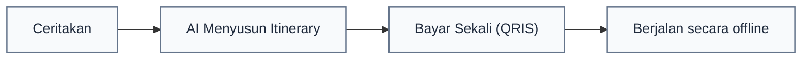

<div align="center">

  

  # Betang<span style="color:#f97316;">GO</span>
  ### Go Beyond, Discover Kalteng — Satu Percakapan, Satu Perjalanan

**[betanggo.vercel.app](betanggo.vercel.app)**
  <p>
    <strong>Aplikasi Travel Planner Cerdas untuk Pariwisata Kalimantan Tengah</strong><br/>
    Karya <strong>Tim Dadakan</strong> pada lomba <strong>Tambun Bungai Ideathon 2026</strong>
  </p>

  

</div>

---

## Latar Belakang & Masalah

Kalimantan Tengah memiliki kekayaan alam dan budaya, mulai dari konservasi orangutan di Taman Nasional Sebangau, susur sungai air hitam Kereng Bangkirai, hingga warisan Rumah Betang Dayak. Namun, wisatawan sering menghadapi kendala:

1. **Informasi Tercecer:** Destinasi, jadwal perahu klotok, akomodasi, dan kuliner belum terpusat.
2. **Pembayaran Terpisah-pisah:** Wisatawan harus mentransfer berkali-kali ke penjual/penyedia jasa.
3. **Sinyal Internet Terbatas:** Di kawasan pedalaman, internet seringkali hilang (*dead zone*).

> **Filosofi BetangGO:**  
> Terinspirasi dari **Huma Betang** (rumah panjang adat Dayak tempat berbagai keluarga hidup rukun di bawah satu atap bersama), **BetangGO** menyatukan seluruh kebutuhan perjalanan wisatawan dan ekosistem lokal ke dalam **satu aplikasi digital**.

---

## Subtema yang Diusung

BetangGO mengintegrasikan **dua subtema strategis sekaligus**:
- **Subtema 3: Digitalisasi Transportasi dan Destinasi Wisata.**  
  Katalog digital, integrasi penyedia jasa transportasi lokal (mobil), hotel dan homestay desa wisata, penyusunan rute berbasis AI.
- **Subtema 5: QRIS Lintas Negara (Cross-Border).**  
  Pembayaran 1-step checkout untuk seluruh perjalanan, mendukung wisatawan domestik maupun wisman mancanegara (Indonesia, Malaysia, Singapura, Thailand).

---

## Poster Ideathon

<div align="center">
  
</div>

---

## Fitur Utama (Core Features)



- 🤖 **Betang AI Smart Planner (Voice & Text):**  
  Cukup katakan *"Saya ingin liburan 3 hari dengan budget 5 juta"*, Betang AI otomatis menyusun jadwal harian, estimasi biaya transportasi, dan hotel dalam hitungan detik.
- 🎙️ **Voice Input Bilingual (ID & EN):**  
  Mengenali suara bahasa Indonesia dan bahasa Inggris untuk memudahkan wisatawan lokal maupun mancanegara.
- 💳 **1-Step Checkout QRIS Terpadu:**  
  Satu kali scan QRIS melunasi seluruh paket perjalanan (tiket konservasi, penginapan, transportasi sungai, hingga belanja UMKM).
- 📶 **100% Ready Mode Offline:**  
  E-Voucher digital dengan QR code secara lokal, tetap aman dan dapat discan petugas tanpa koneksi internet.
- 🧭 **Direktori Lengkap Kalteng:**  
  40+ destinasi wisata alam, cagar budaya, homestay lokal, dan sentra kerajinan Dayak.
- 📱 **UI Modern:**  
  Menggunakan color palet Bumi (*Rimba Deep, Pakis Green, Dayak Orange, Rotan Gold*).
- 🌍 **2 Bahasa, 2 Mode:**
  Bahasa Indonesia dan Bahasa Inggris, Mode Terang dan Mode Gelap.

---

## 💻 Tech Stack

Aplikasi ini dibangun menggunakan arsitektur modern dengan performa tinggi dan tetap ringan.

| Komponen | Teknologi | Keterangan |
|---|---|---|
| **Frontend Framework** | **React 19** + **TypeScript 5** | UI reaktif dan komponen berbasis modern hooks |
| **Build Tool & Bundler** | **Vite 6** | *Lightning-fast* HMR development dan build produksi teroptimasi |
| **Styling & Design System** | **Tailwind CSS v4** | Sistem token warna Kalteng, tipografi Plus Jakarta Sans, dan layout responsif |
| **Motion & Animasi** | **Motion (Framer Motion)** | Transisi halus, *text loop*, dan interaksi mikro |
| **Monorepo Manager** | **pnpm Workspaces** | Struktur monorepo multi-paket (`apps/web`, `apps/remotion`, `packages/shared`, `packages/solver`) |
| **Offline Storage & Auth** | **LocalStorage + Web Crypto (Ed25519)** | Penyimpanan tiket offline dan verifikasi tiket digital tanpa internet |
| **Deployment** | **Vercel** | Hosting Web App |

<div align="center">
  
</div>

---

## 🎬 Video Pitch

- **Link Video Pitch (Google Drive):**  
  👉 **[Buka Video Pitch BetangGO di Google Drive](https://drive.google.com/file/d/1tc19lFFY9r6ANR_zyz8dMSYJZFHGvRfl/view?usp=sharing)**  
---

## 📁 Struktur Direktori

```
BetangGO/
├── apps/
│   ├── web/                    # Aplikasi utama React 19 PWA (UI, Screens, Router, i18n ID/EN)
│   └── remotion/               # Generator video animasi pitch 1080p berbasis React & Remotion
├── packages/
│   ├── shared/                 # Model tipe data TypeScript, konstanta, & seed 40+ destinasi Kalteng
│   └── solver/                 # Isomorphic Itinerary Solver (algoritma alokasi rute & kalkulasi budget)
├── media/                      # Aset poster, video bumper, audio voiceover, dan video pitch
│   ├── Tim Dadakan_BetangGO_Poster.png
│   ├── Tim Dadakan_BetangGO_Materi Pendukung.JPG
│   ├── icon.png
│   ├── icon.gif
├── pnpm-workspace.yaml         # Konfigurasi monorepo pnpm
└── README.md
```

---

## 🛠️ Panduan Menjalankan 

### 1. Syarat
- **Node.js:** Versi 20.x atau lebih baru (disarankan v22+)
- **pnpm:** Versi 9+ atau 12+ (`corepack enable` atau `npm i -g pnpm`)

### 2. Install Dependensi
Clone repository dan jalankan instalasi paket dari root:
```bash
git clone https://github.com/imdfauzan/BETANGGO
cd BetangGO
pnpm install
```

### 3. Run Web App
```bash
pnpm dev
# atau
npm run dev
```
Buka browser: **`localhost:5173`**.  

### 4. Build Produksi
```bash
pnpm build
```
---

## 👥 Tim Dadakan

Inovasi ini diajukan untuk **Tambun Bungai Ideathon 2026**:

- **Christiano Ronaldo Silalahi**
- **Imam Mahmud Dalil Fauzan**
- **Ahmad Yafi Ar Rizq**

---

<div align="center">
  <sub>© 2026 Tim Dadakan • <a href="https://betanggo.vercel.app">betanggo.vercel.app</a></sub>
</div>
